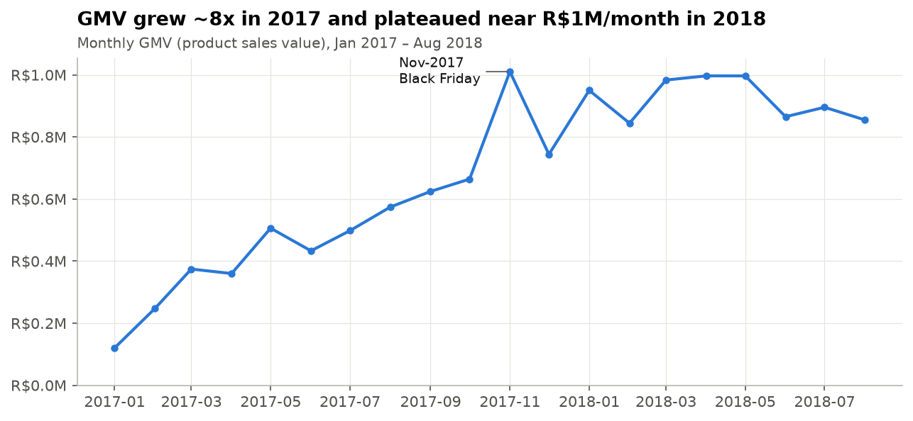
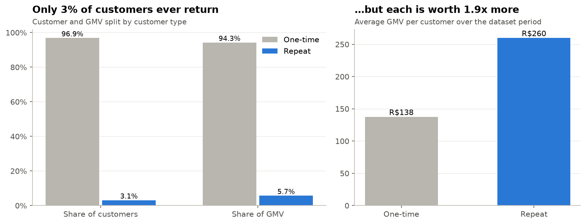
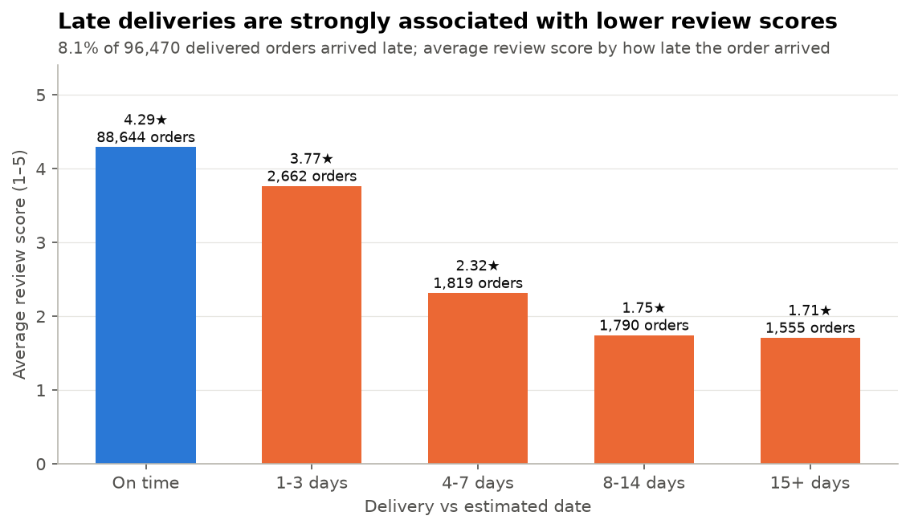
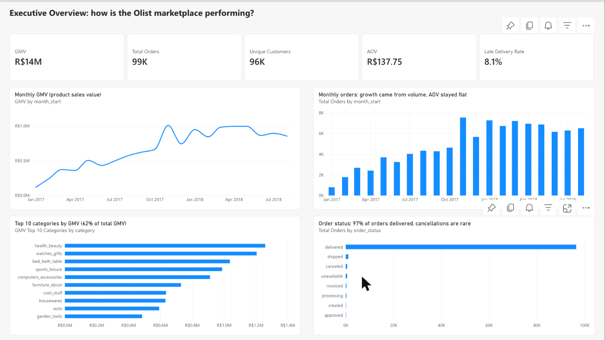
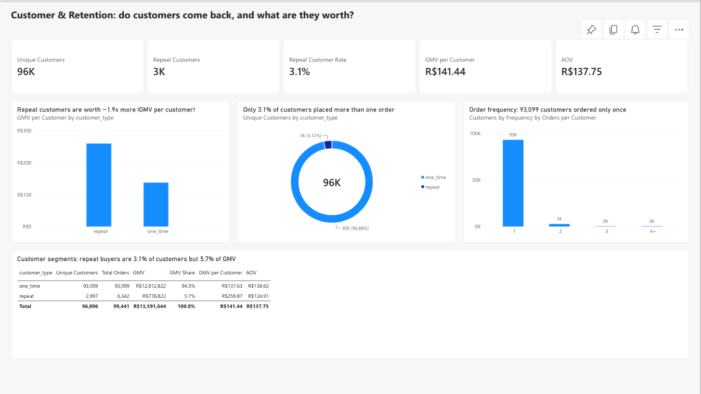
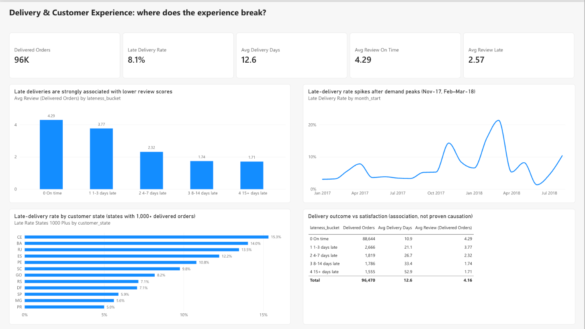
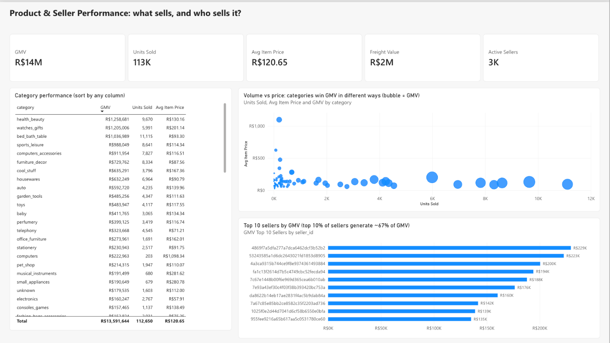

# Olist E-commerce Analytics: Sales, Retention & Delivery Experience

End-to-end analysis of **~100K orders (2016–2018)** from Olist, a Brazilian online marketplace. The analysis uses **PostgreSQL, Python/Pandas, Matplotlib and Power BI** and turns raw transactional data into business recommendations on growth, customer retention, delivery reliability and seller quality.

## Business objective
Olist connects small sellers to customers across Brazil. Management wants to know:
1. **How is the marketplace growing, and what drives the growth?**
2. **Which categories and sellers generate sales?**
3. **Do customers come back, and how much are repeat customers worth?**
4. **How reliable is delivery, and how does it relate to customer satisfaction?**
5. **How do customers pay?**

## Dataset
[Brazilian E-Commerce Public Dataset by Olist](https://www.kaggle.com/datasets/olistbr/brazilian-ecommerce) (Kaggle). The dataset has 9 relational tables: orders, order items, customers, products, sellers, payments, reviews, geolocation and category translation. It covers Sep-2016 to Oct-2018, and all values are in Brazilian reais (R$).

## Tech stack
| Layer | Tools |
|---|---|
| Database & SQL | PostgreSQL: schema with PK/FK constraints, CTEs, window functions (`LAG`, `RANK`, `NTILE`, running totals), `FILTER`, a reusable view |
| Cleaning & analysis | Python, Pandas, NumPy |
| Visualization | Matplotlib (Jupyter) |
| Dashboard | Power BI Service: semantic model (5 relationships, 30 DAX measures, TMDL), 4-page report |

## Project structure
```
olist_ecommerce_analysis/
├── dashboard/
│   ├── powerbi_dashboard.pbix  Power BI report + data model
│   └── powerbi_data/     compact tables the Power BI semantic model was built from
├── data/
│   ├── raw/              original Kaggle CSVs (git-ignored, download yourself)
│   └── cleaned/          cleaned + derived tables (Power-BI-ready)
├── docs/
│   ├── notes.md                    metric definitions, assumptions, cleaning decisions
│   └── powerbi_implementation.md   as-built Power BI model, DAX measures, pages, verification
├── images/               notebook charts + Power BI page screenshots
├── notebooks/
│   ├── 01_eda.ipynb              exploratory analysis of raw data
│   └── 02_visualizations.ipynb   8 storytelling charts
├── outputs/              summary tables written by python/analysis.py
├── python/
│   ├── data_cleaning.py  quality checks, cleaning, derived columns
│   ├── analysis.py       business analysis (sections A–H)
│   └── export_powerbi.py tables for the Power BI semantic model
├── sql/
│   ├── 01_create_tables.sql      schema + constraints
│   ├── 02_load_data.sql          \copy load from data/raw
│   ├── 03_data_validation.sql    nulls, keys, integrity, date & value checks
│   ├── 04_exploratory_analysis.sql
│   └── 05_business_analysis.sql  10 business questions + vw_order_summary
└── requirements.txt
```

## Data pipeline
```
Raw Olist CSVs ──► PostgreSQL (01–03: schema, load, validation) ──► SQL analysis (04–05)
      │
      └──► data_cleaning.py ──► data/cleaned/ ──► analysis.py / notebooks ──► charts
                                     └──► export_powerbi.py ──► Power BI semantic model ──► dashboard
```
The SQL and Python pipelines each start from the raw data and implement the same metric definitions. Their headline outputs reconcile exactly: GMV, orders, customers, late rate and the customer-frequency distribution all match.

**Key definitions** (full list in [docs/notes.md](docs/notes.md)):
- **GMV** = sum of item prices (product sales value, excluding freight). "Revenue" is avoided because Olist's revenue would be its commission, which is not in the data.
- **AOV** = GMV ÷ orders with items.
- **Customer** = `customer_unique_id`. `customer_id` is generated per order, so using it would show zero repeat customers.
- **Late delivery** = delivered after the estimated date. Only delivered orders with both dates are evaluated; undelivered orders are never counted as "on time".

## Key findings

| KPI | Value |
|---|---|
| Orders | 99,441 |
| Unique customers | 96,096 |
| GMV | R$13.59M (+ R$2.25M freight) |
| AOV | R$137.75 |
| Late delivery rate | 8.1% of 96,470 delivered orders |
| Average delivery time | 12.6 days |

**1. Growth came from order volume, not basket size.** GMV rose from R$120K (Jan-2017) to roughly R$1M per month in 2018, which is **+137% for Jan–Aug 2018 vs Jan–Aug 2017**. AOV stayed between R$125 and R$153 throughout. Nov-2017 (Black Friday) was the peak month.



**2. Sales are concentrated.** The top 10 of 74 categories generate **62% of GMV**. Categories win in different ways: *bed_bath_table* leads on units at an average price of R$93, while *watches_gifts* is #2 by GMV on an average price of R$201. The top 10% of sellers generate **~67% of GMV**.

**3. Retention is the biggest gap.** Only **3.1% of customers placed more than one order**. Those repeat customers spend **1.9x more in total** (R$260 vs R$138 GMV per customer) and contribute 5.7% of GMV.



**4. Late deliveries are strongly associated with poor reviews.** On-time orders average **4.29★**, while late orders average **2.57★**, and 54% of late orders received a 1–2★ review (vs 9% of on-time orders). Scores fall steadily with lateness: 3.77★ at 1–3 days late, ~1.7★ at 8+ days late. Late rates spike after demand peaks (Nov-2017 14%, Mar-2018 21%). They are highest in RJ, BA and CE (13–15%), more than double the rate in SP (5.9%). This is a correlation, not a proven causal effect.



**5. Credit card dominates payments.** Credit cards carry 78% of payment value, and two-thirds of card payments are split into installments. Average payment rises from R$96 (1 installment) to R$334 (7–10 installments). Boleto (bank slip) carries 18%.

**6. A small set of sellers has quality problems.** 19 of the 429 established sellers (≥50 orders) average below 3.5★. Their late rate is 15.7%, against 7.5% for the other established sellers.

## Business recommendations
1. **Make retention a growth lever.** Run post-purchase campaigns (second-order vouchers, category cross-sell) aimed at the 97% of customers who buy once. Moving the repeat rate from 3% to 5% would add a customer segment worth ~1.9x the average.
2. **Plan logistics capacity for peaks.** Late rates jumped after Black Friday and in Feb–Mar 2018. Add carrier capacity and pad delivery estimates during peak periods.
3. **Set regional delivery promises.** For the North/Northeast and RJ, set realistic estimated dates (or regional carrier SLAs), since missing the estimate is what correlates with poor reviews.
4. **Manage seller performance.** Monitor late rate and rating for each established seller. Use coaching, then ranking penalties, for the sellers below 3.5★, who account for only 3.4% of GMV.
5. **Protect the head categories.** Prioritise stock, delivery and promotions in the top-10 categories (62% of GMV), and use installment offers on high-ticket categories such as watches/gifts.

## Visualizations
[`notebooks/02_visualizations.ipynb`](notebooks/02_visualizations.ipynb) contains 8 charts: monthly GMV, monthly orders, top categories by GMV, top categories by units, one-time vs repeat customers, order status, review score by lateness, and seller concentration. All charts are exported to [`images/`](images/).

## Dashboard
A 4-page **Power BI** report (*Olist E-Commerce Performance Dashboard*) built on a semantic model with 5 relationships and 30 DAX measures. Every KPI was cross-checked against the Python and SQL results. The file is [`dashboard/powerbi_dashboard.pbix`](dashboard/powerbi_dashboard.pbix); open it in Power BI Desktop. The full model, measures and verification are in [docs/powerbi_implementation.md](docs/powerbi_implementation.md).

| Executive Overview | Customer & Retention |
|---|---|
|  |  |
| **Delivery & Experience** | **Product & Seller** |
|  |  |

## How to run
```bash
python -m venv .venv && source .venv/bin/activate
pip install -r requirements.txt
# Download the Kaggle dataset and put the 9 CSVs in data/raw/
python python/data_cleaning.py      # checks + writes data/cleaned/
python python/analysis.py           # prints analysis, writes outputs/
python python/export_powerbi.py     # tables for the Power BI model
jupyter notebook notebooks/         # run 01_eda and 02_visualizations
```

### PostgreSQL
Run from the project root, because `\copy` paths are relative to it:
```bash
createdb olist
psql -d olist -f sql/01_create_tables.sql
psql -d olist -f sql/02_load_data.sql
psql -d olist -f sql/03_data_validation.sql
psql -d olist -f sql/04_exploratory_analysis.sql
psql -d olist -f sql/05_business_analysis.sql
```
Add `-U <your_user>` if needed. No credentials are stored in this repository.

## Limitations
- Findings are observational. Delivery delays and low ratings are associated, but other factors (product, seller, region) are not controlled for.
- The repeat rate is measured over a ~2-year window. Customers who joined late in the period had less time to return.
- No cost or commission data, so profitability cannot be assessed. GMV includes the 0.7% from canceled orders, and refunds are not visible.
- Partial months (2016, Sep–Oct 2018) are excluded from trend charts.

## Future improvements
- Cohort retention curves (repeat purchase by first-purchase month).
- A regression controlling for category, seller and state, to estimate the delivery–review relationship more rigorously.
